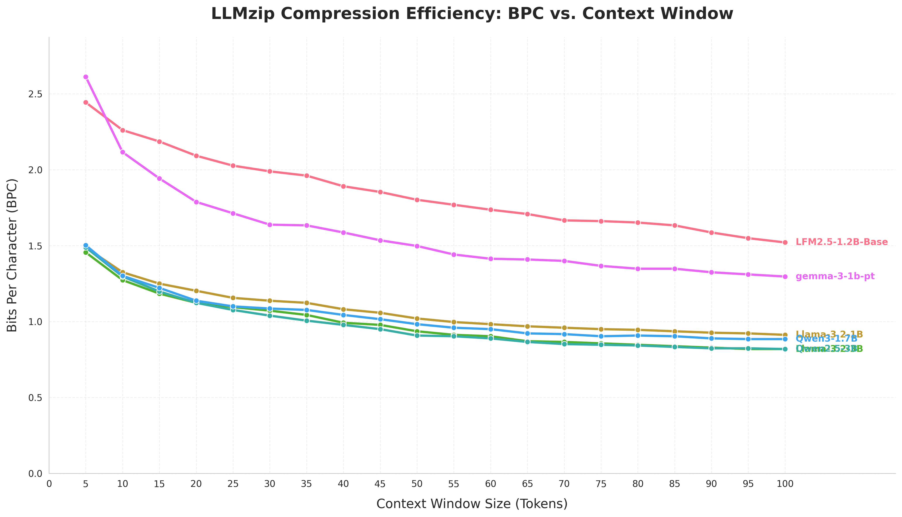
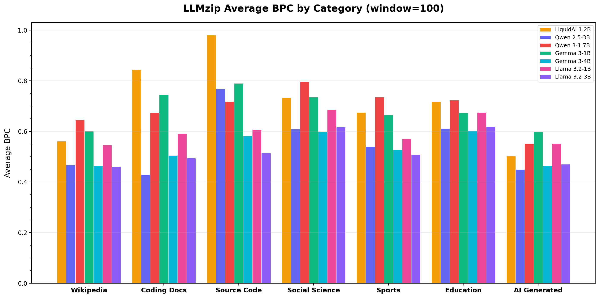

# llmzip_extension

Experiments on compressing text with a language model's next-token probabilities and arithmetic coding (the LLMzip approach).

The arithmetic coder and encode/decode scripts are in `core/`. Scripts under `experiments/natural_language_entropy/` run compression benchmarks across several models and text sources, plus a self-compression comparison. Result files and plots are in `data/` and `results/`.





All plots are under `results/natural_language_entropy/`. They come from the plotting scripts in `plots/` and `experiments/natural_language_entropy/`. The `plots/` scripts read a `benchmarks.db` SQLite file from the working directory; the committed copy is `data/benchmarks.db`.

## Tech

- Python, PyTorch, Hugging Face Transformers
- Arithmetic coding in `core/AC/arithmeticcoding.py` (based on Project Nayuki's reference arithmetic coding; the file keeps its original header)
- SQLite (`data/benchmarks.db`, created by `setup/setup_db.py`) for benchmark results
- Matplotlib, pandas, and seaborn for plots

## Layout

- `core/`: `encode_story.py`, `decode_story.py`, and the arithmetic coder in `core/AC/`.
- `experiments/natural_language_entropy/`: `llmzip_qwen.py` (the `LLMzipQwen` wrapper), benchmark sweeps, self-compression runs, and code generation.
- `experiments/generative_reconstruction_compression/generative_compression.py`: a prototype that sends a prompt, a seed, and a diff against an LLM-generated candidate.
- `setup/`: `setup_db.py` creates the SQLite tables; `populate_sources.py` fills the `data_sources` table with 35 texts in 7 categories and writes them to `source_text/`.
- `plots/`: plotting scripts.
- `benchmarks/test_vram_safety.py`: a manual VRAM headroom check that expects a GPU and local model paths.

## Setup

```sh
python3 -m venv .venv
. .venv/bin/activate
pip install torch numpy transformers matplotlib pandas seaborn requests
```

There is no requirements file. The list above is taken from the imports in the scripts. Install the PyTorch build that matches your hardware.

The scripts set `HSA_OVERRIDE_GFX_VERSION=10.3.0` for ROCm on an AMD RX 6000-series GPU, and several of them point at model snapshots under a local Hugging Face cache (`/home/alexn/.cache/huggingface/...`). Edit those paths for your machine.

## Running

Commands already written in those files:

- `experiments/natural_language_entropy/run_self_compression.py`: `../.venv/bin/python3 run_self_compression.py`
- `experiments/natural_language_entropy/generate_code.py`: `.venv/bin/python3 generate_code.py --model <path> --slug <name> --count 8`
- `experiments/natural_language_entropy/plot_self_compression.py`: `.venv/bin/python3 plot_self_compression.py`
- `core/encode_story.py` and `core/decode_story.py` take `--model`, `--input`, `--output`, `--window-size`, and `--bf16`.

`sweep_data_sources.py` and `plots/plot_data_sources.py` also have usage comments at the top of the file. `agents.md` names `qwen_generation.py`, `benchmark_tps.py`, `benchmark_kv.py`, and `arithmetic_encoding.py`, which are not in this repository.

## CI

There are no CPU-runnable unit tests, so CI only byte-compiles every Python file as a syntax smoke check.

## License

MIT, see `LICENSE`.
